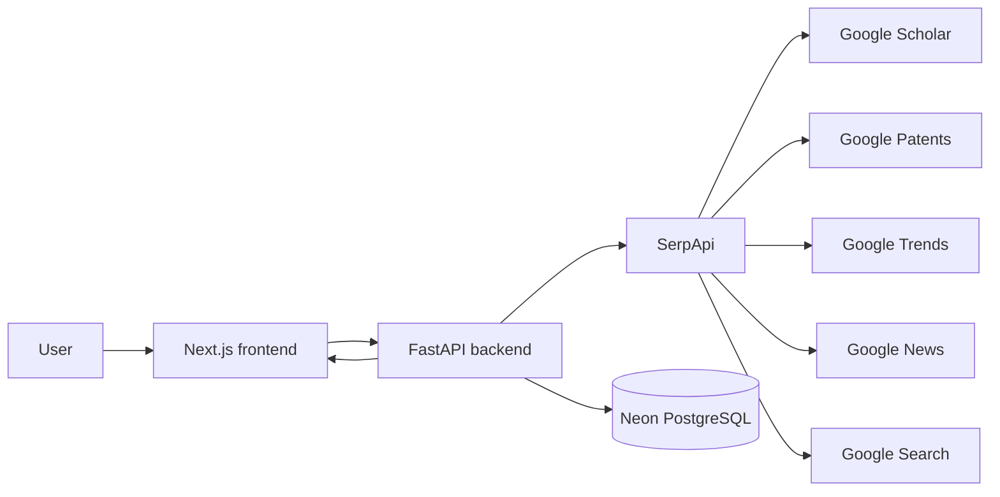

# GAP — Technology Opportunity Intelligence

**See where the signals don't agree.**

GAP is a technology opportunity intelligence platform that combines live research, patent, attention, commercial-event, and market-presence signals to surface technology subdomains where technical momentum and demand appear strong while visible market saturation remains comparatively low.

**Live demo:** https://gap-technology-opportunity-intellig.vercel.app/  
**API:** https://gap-tpproduction.up.railway.app/  
**API docs:** https://gap-tpproduction.up.railway.app/docs

## Why GAP exists

Technology opportunity research is usually fragmented across papers, patents, news, search visibility, and trend data. GAP brings those signals into one workflow so a user can compare subdomains, inspect evidence, and understand *why* an area ranks the way it does.

GAP does **not** claim to predict the future. Its score is a transparent heuristic for prioritizing areas for deeper investigation.

## What it does

A user enters a technology area and a set of subdomains. GAP then:

1. builds a multi-source SerpApi query plan,
2. retrieves live evidence from five search engines,
3. derives normalized signal values,
4. computes technical momentum, demand, market presence, confidence, whitespace, and GAP score,
5. ranks the subdomains,
6. visualizes the landscape in an Opportunity Map and Signal Matrix,
7. preserves source-level evidence for inspection.

## SerpApi usage

SerpApi is core infrastructure for GAP rather than an optional enrichment layer.

GAP uses:

- **Google Scholar API** — baseline and recent research activity
- **Google Patents API** — baseline and recent patent activity
- **Google Trends API** — attention momentum across subdomains
- **Google News API** — recent commercial events such as launches, funding, partnerships, and products
- **Google Search API** — visible market presence across companies, products, and platforms

For a six-subdomain analysis, GAP typically executes 38 planned SerpApi searches: 36 subdomain-level searches plus two batched Google Trends requests.

Search responses are normalized into a common evidence model and cached by query fingerprint to avoid unnecessary repeated SerpApi calls.

## Signal model

GAP derives five primary signals:

- **R — Research**
- **P — Patents**
- **A — Attention**
- **E — Commercial-event momentum**
- **M — Visible market presence**

The current heuristic is:

```text
technical = 0.55R + 0.45P
demand = 0.55A + 0.45E
whitespace = technical × demand × (1 - M)
GAP score = whitespace × confidence
```

These coefficients are intentionally transparent heuristics, not scientifically validated forecasting weights.

A missing required source is treated as **unknown**, not zero. If required signals are unavailable, GAP avoids producing a misleading opportunity score.

## Opportunity Map

The Landscape screen maps:

- **X-axis:** technical momentum
- **Y-axis:** demand momentum
- **Bubble size:** GAP score
- **Opacity:** confidence
- **Outer ring:** visible market presence

This makes disagreement between technical momentum, demand, and market visibility easy to inspect visually.

## Architecture



## Tech stack

**Frontend**
- Next.js 15
- React 19
- TypeScript
- CSS / responsive interactive visualizations
- Vercel

**Backend**
- Python
- FastAPI
- Uvicorn
- HTTPX
- Pydantic
- Psycopg
- Railway

**Data**
- Neon PostgreSQL
- SerpApi live search data
- local query-response cache for repeated searches

## Run locally

### 1. Clone

```bash
git clone https://github.com/TanayP26/gap-technology-opportunity-intelligence.git
cd gap-technology-opportunity-intelligence
```

### 2. Backend

Create `backend/.env`:

```env
APP_ENV=development
APP_PORT=8050
SERPAPI_API_KEY=your_serpapi_api_key
DATABASE_URL=your_postgresql_connection_string
ALLOWED_ORIGINS=http://localhost:3000
SEARCH_CACHE_DIR=.cache/serpapi
SERPAPI_CONCURRENCY=5
```

Install and run:

```bash
cd backend
python -m venv .venv
# Windows:
.venv\Scripts\python -m pip install .
.venv\Scripts\python -m uvicorn app.main:app --host 127.0.0.1 --port 8050 --reload
```

The API will be available at `http://127.0.0.1:8050`.

### 3. Database migrations

From the repository root, with `DATABASE_URL` available in the environment:

```bash
python scripts/apply_migrations.py
```

The migration runner applies:

- `001_initial.sql`
- `002_phase3.sql`
- `003_scoring_integrity.sql`

### 4. Frontend

Create `frontend/.env.local`:

```env
NEXT_PUBLIC_API_BASE_URL=http://127.0.0.1:8050
```

Then:

```bash
cd frontend
npm install
npm run dev
```

Open `http://localhost:3000`.

## Main API endpoints

```text
GET  /health
POST /api/v1/analyses/preview
POST /api/v1/analyses/score
POST /api/v1/analyses/probe
POST /api/v1/analyses
GET  /api/v1/analyses/{analysis_id}
GET  /api/v1/analyses/{analysis_id}/landscape
GET  /api/v1/subdomains/{subdomain_id}/evidence
```

Interactive OpenAPI documentation is available at `/docs`.

## Reliability and scoring integrity

GAP includes safeguards designed specifically for multi-source search intelligence:

- missing sources are not silently converted to zero,
- failed required signals can invalidate a score instead of creating artificial whitespace,
- source-run status is preserved,
- evidence is stored alongside the derived signal values,
- repeated SerpApi calls can be served from the local cache,
- analyses are persisted in PostgreSQL.

## Deployment

- **Frontend:** Vercel
- **Backend:** Railway
- **Database:** Neon PostgreSQL

Production backend health:

```text
https://gap-tpproduction.up.railway.app/health
```

## Hackathon

Built for the **SerpApi India Hackathon 2026**.

Primary fit: **Knowledge & Public Interest**, because GAP turns live Scholar, Patents, News, Trends, and Search data into a research and technology-intelligence workflow.

## License / usage note

This repository contains the hackathon implementation of GAP. Search results remain attributable to their original sources and are retrieved through SerpApi. GAP scores are decision-support heuristics and should be treated as signals for further research rather than predictions or investment advice.
